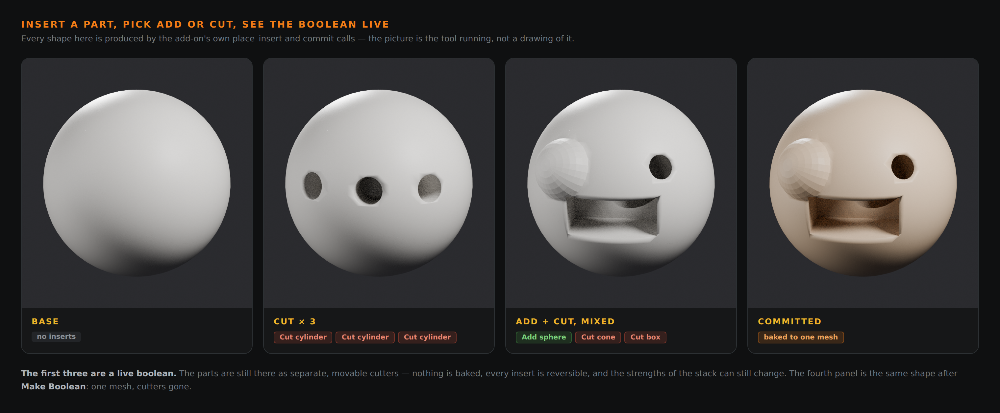
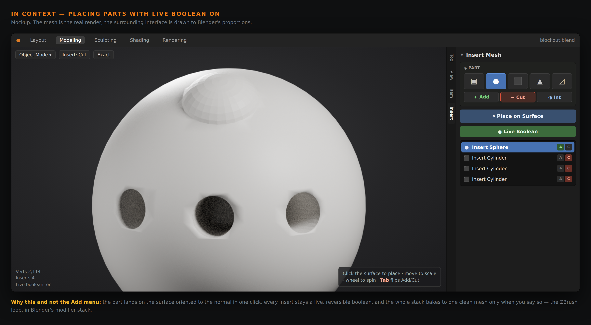
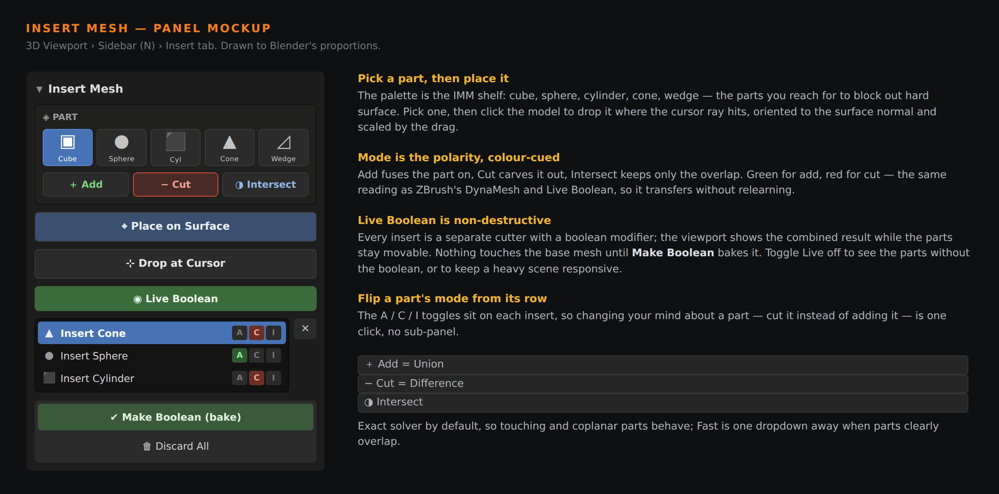

# Insert Mesh + Live Boolean

ZBrush-style part insertion and live booleans for Blender. **Prototype — v0.1.0.**

Two things ZBrush does that Blender makes you do by hand: **Insert Mesh** —
stamp a part onto the surface, oriented to the normal — and **Live Boolean** —
see Add / Cut / Intersect combine in the viewport and commit only when you're
happy. This is a working prototype of both, built on Blender's own Boolean
modifier stack, which is also the honest way to do a live boolean by hand.



Those four shapes are produced by the add-on's own `place_insert` and `commit`
calls — the picture is the tool running, not a drawing of it. The first three
are a live boolean; the parts are still separate movable cutters and nothing is
baked. The fourth is after **Make Boolean**: one mesh, cutters gone.





---

## What it does

- **A part palette** — cube, sphere, cylinder, cone, wedge — the IMM shelf.
- **Place on the surface**: click where the cursor ray hits, the part lands
  oriented to the surface normal, scaled by the drag, spun with the wheel.
- **Polarity per part**: Add (union), Cut (difference), Intersect — colour-cued
  green/red the way ZBrush's DynaMesh and Live Boolean read.
- **Live Boolean**: the combined result shows in the viewport and in renders,
  while every part stays a separate, movable, reversible cutter.
- **Flip a part's mode from its row**, delete a part, change the solver.
- **Make Boolean** bakes the stack into one mesh; **Discard** removes every
  part and leaves the base untouched.

## Install

**Blender 4.2+:** zip the `insert-mesh` folder, install from
`Edit ▸ Preferences ▸ Get Extensions ▸ Install from Disk`.

**Blender 4.0–4.1:** zip the inner `insert_mesh` folder, install from
`Edit ▸ Preferences ▸ Add-ons ▸ Install`.

Open the viewport sidebar with **N**, pick the **Insert** tab.

## Using it

1. Pick a part and a mode (Add / Cut / Intersect).
2. **Place on Surface** and click the model — the part lands on the surface.
3. Place more. Each one combines live; the mesh updates as you go.
4. Flip any part's mode, hide the preview with **Live Boolean**, or reorder.
5. **Make Boolean** when you're happy, or **Discard** to walk it all back.

---

## How it works

Each insert is a separate **cutter** object plus a **Boolean modifier** on the
target that references it:

- Cutters display as wireframe and are hidden from render, so the viewport and
  final render show the boolean result while you still have the parts to move.
- Polarity maps straight onto the modifier operation — Add→Union, Cut→Difference,
  Intersect→Intersect — which is why the prototype is non-destructive for free.
- Modifiers apply top-down, so the order you place parts is the boolean order.
- **Make Boolean** evaluates the whole stack once, writes the result back onto
  the mesh, and deletes the cutters. Nothing is baked before that.

### Placement

`core.placement_matrix(hit, normal, scale, roll, sink)` turns a click into a
transform. It maps the part's local +Z onto the surface normal (so the part
stands up out of the surface), applies the scale and the roll about the normal,
and `sink` pushes the part into the surface so a cutter straddles it. A cutter
has to protrude for a Cut to carve anything — `sink` must stay below the part's
half-height, which the demo script learned the hard way.

---

## Limits

Named here rather than discovered later:

- **Booleans are only as robust as the geometry.** Self-intersecting targets,
  non-manifold meshes and exactly-coincident faces can still confuse the Exact
  solver. The library parts are all watertight (there is a test for it), but
  your target mesh is your responsibility.
- **Scales with part count.** Every live insert is another modifier evaluated
  on every viewport update. Dozens are fine; hundreds will crawl. Toggle Live
  off, or commit in batches.
- **The interactive placement is not tested headless.** The click-to-place
  modal operator needs a window; its placement maths is tested on its own, but
  the modal interaction itself has only been reviewed as code.
- **No undo coalescing for the modal.** Each placed part is its own undo step.
- **Baked result inherits the solver's topology** — the n-gons a boolean
  produces. Fine for blockout; retopo for anything that will deform.

---

## Tests

15 tests, covering the placement maths, the part library's watertightness, each
boolean polarity's effect on volume, non-destructiveness, commit/discard, and
the property-callback recursion that an earlier version shipped:

```
blender -b -P tools/insert-mesh/tests/test_insert_mesh.py
```

Booleans are verified by measuring enclosed volume before and after — a Cut
must shrink it, an Add must grow it, an Intersect must keep less than either
input. All 15 pass on Blender 4.0.2.

Demo renders regenerate with:

```
blender -b -P tools/insert-mesh/tests/make_demo_renders.py
```

## Layout

```
insert_mesh/
  core.py       placement maths, the part library, volume/watertight checks
  bridge.py     target <-> cutter glue; the only place that touches modifiers
  props.py      the insert stack
  ops.py        operators, incl. the click-to-place modal
  ui.py         palette panel and list
  __init__.py
tests/
  test_insert_mesh.py     15 headless tests
  make_demo_renders.py    the renders above, from the add-on's own calls
```

## Next, if this is worth continuing

1. A proper drag-to-scale and gizmo on the just-placed part.
2. A custom-part library — save any selected mesh into the palette (true IMM).
3. Auto-commit older inserts past a count threshold, to keep the stack light.
4. Remesh-on-commit option, for a watertight DynaMesh-style result.
