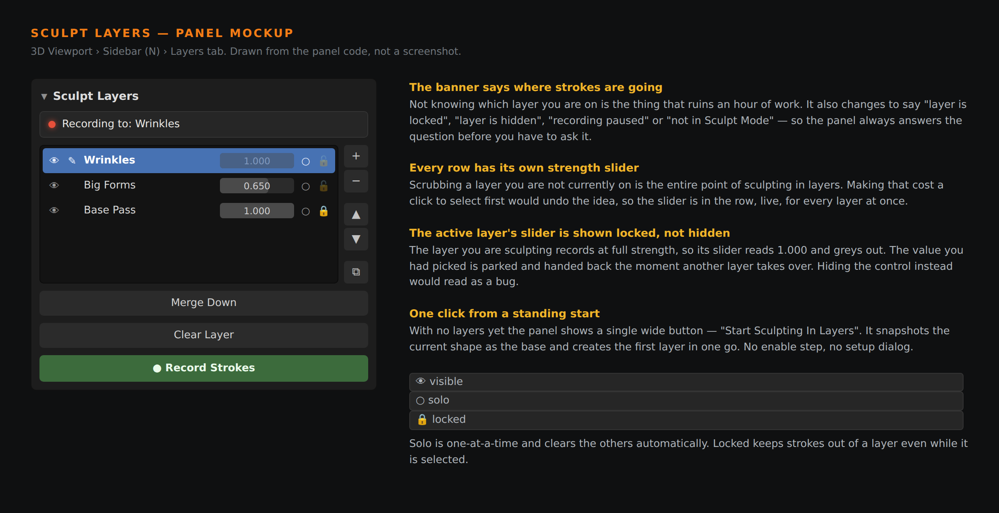

# Sculpt Layers

Non-destructive layers for Blender's sculpt mode. **Prototype — v0.1.0.**

Blender has no sculpt layer system. ZBrush has had one for twenty years, and
it is the feature people miss most when they move across: the ability to put
wrinkles on one layer, big forms on another, and dial either of them back
afterwards without redoing the work.

This is a working prototype of that.



---

## What it does

- **Layers of sculpt deformation.** Each layer stores a per-vertex offset from
  a base shape. What you see is the base plus every visible layer.
- **Per-layer strength**, live. Scrub a layer down to 40% and the mesh updates
  as you drag. Overshoot past 1.0 if you want more than you sculpted.
- **Strokes land on the active layer** automatically. There is no record
  button to remember and no mode to be in.
- **Visibility, solo and lock** per layer.
- **Merge down, duplicate, clear, reorder.**
- **Apply all** bakes the stack into the mesh; **discard** returns it to base.
- **Survives save and reload.**

## Install

**Blender 4.2 and later:** zip the `sculpt-layers` folder and install it from
`Edit ▸ Preferences ▸ Get Extensions ▸ Install from Disk`.

**Blender 4.0–4.1:** zip the inner `sculpt_layers` folder and install from
`Edit ▸ Preferences ▸ Add-ons ▸ Install`.

Then open the 3D viewport sidebar with **N** and pick the **Layers** tab.

## Using it

1. Select a mesh and press **Start Sculpting In Layers**. Its current shape
   becomes the base.
2. Sculpt. Everything goes onto the layer named in the banner.
3. Press **+** for a new layer. Sculpt again.
4. Drag any other layer's strength slider and watch that pass fade in or out.

---

## How it works

An object under layer control keeps a **base**: the vertex positions as they
were when layers were switched on. Each layer holds an array of per-vertex
offsets from that base. The viewport shows

```
coords = base + Σ (offset_i × strength_i)    for visible layers
```

Sculpting is not intercepted. Vertices move the way they always do, and after
each depsgraph update the active layer's offset is recomputed as *whatever is
left once every other layer is accounted for*. That one subtraction is what
makes strokes land on the active layer and nowhere else.

### Why the active layer always sits at full strength

The layer you are sculpting records and displays at 1.0, and its slider greys
out. The strength you had chosen is parked in `stored_strength` and handed
back the moment another layer becomes active.

The alternative — recording onto a layer displayed at, say, 0.2 — means
dividing the captured stroke by 0.2 to work out what to store, which
multiplies float error by five and makes a smooth stroke come back grainy.
ZBrush solves it the same way, and it costs nothing: you finish the layer,
then dial it.

---

## Limits

Named here rather than discovered later:

- **The vertex count must not change.** Layers store a position per vertex, so
  Dyntopo, remeshing and anything that adds or removes geometry break the
  link. The add-on detects this, stops applying layers rather than corrupting
  the mesh, and offers to reset the base.
- **Multires is not handled.** Sculpting on a multires modifier writes to
  displacement data, not to vertex positions, so this prototype does not see
  it.
- **Dense meshes will lag.** Capture reads every vertex position after each
  depsgraph update. Around 300k vertices the panel starts warning about it.
  A real version would capture on stroke end, or only over the brush's
  affected region.
- **Layer data lives in the .blend as base64 ID properties.** It round-trips
  correctly, but a heavy mesh with several layers will add noticeably to file
  size.
- **Not tested in a GUI session.** The logic below has a test suite; the
  panel layout has only been reviewed as code and as the mockup above.

---

## Tests

18 tests, covering the layer arithmetic, every operator, persistence, and the
vertex-count failure path:

```
blender -b -P tools/sculpt-layers/tests/test_sculpt_layers.py
```

Sculpting cannot be driven without a window, so strokes are simulated exactly
as the add-on sees them — vertices move, then the capture step runs. That is
what the depsgraph handler does, so the arithmetic under test is the real
thing.

All 18 pass on Blender 4.0.2.

## Layout

```
sculpt_layers/
  core.py       layer arithmetic and persistence — no bpy context, testable
  bridge.py     object <-> array glue; the only place that moves vertices
  props.py      the layer list
  ops.py        operators
  ui.py         panel and list
  handlers.py   stroke capture, save/load
```

## Next, if this is worth continuing

1. Capture on stroke end instead of per depsgraph update — the single biggest
   performance win available.
2. Multires support.
3. Masks per layer.
4. Record a layer's offsets as a shape key on export, so layers can leave
   Blender.
